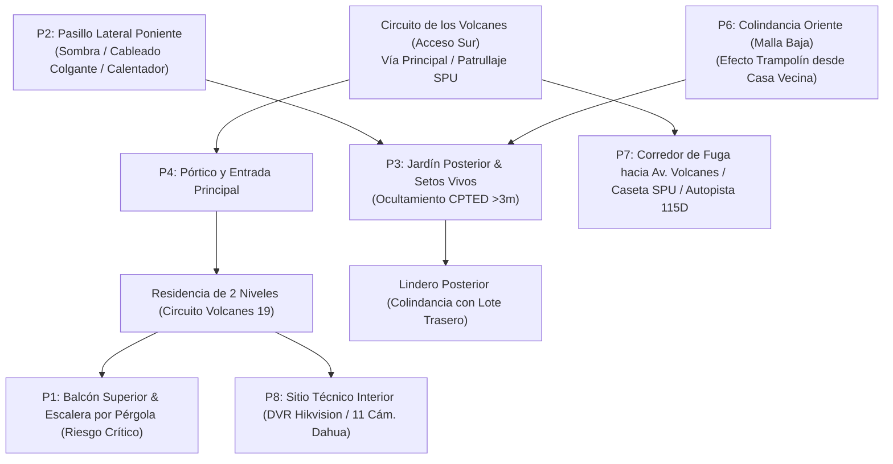
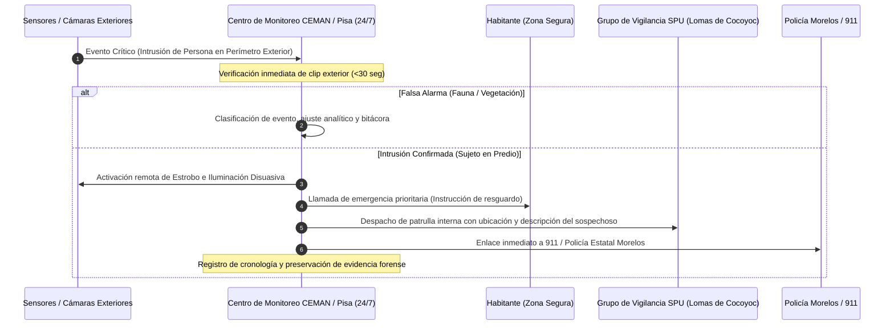

# DICTAMEN DE SEGURIDAD PATRIMONIAL, DIAGNÓSTICO CPTED Y PROPUESTA DE MONITOREO CCTV 24/7
## Residencia Particular — Circuito de los Volcanes 19, Fraccionamiento Lomas de Cocoyoc
### Municipio de Atlatlahucan, Morelos • C.P. 62847

**Inmueble:** Residencia Particular Unifamiliar  
**Ubicación Oficial:** Circuito de los Volcanes No. 19, Fraccionamiento Lomas de Cocoyoc, C.P. 62847, Atlatlahucan, Morelos  
**Coordenadas Geográficas:** `18.921390° N, -98.920426° W`  
**Evento de Referencia:** Intrusión no autorizada reportada el **18 de septiembre de 2026**  
**Fecha del Dictamen:** Noviembre 2026  
**Elaboró:** Centro de Monitoreo y Análisis de Seguridad (CEMAN / Pisa Security SOC)  
**Estatus:** Diagnóstico Integral de Riesgos y Proyecto Ejecutivo de Adaptación Tecnológica  

---

## 1. RESUMEN EJECUTIVO Y OBJETIVOS DEL DICTAMEN

El presente dictamen técnico y criminológico se emite a solicitud de la habitante y propietaria del inmueble ubicado en **Circuito de los Volcanes 19**, tras el evento crítico de **intrusión no autorizada registrado el 18 de septiembre de 2026**.

El objetivo es formular un análisis riguroso de riesgos físicos, ambientales y delictivos, sustentado en:
1. **Estadística criminal oficial** del Secretariado Ejecutivo del Sistema Nacional de Seguridad Pública (**SESNSP**) para el municipio de Atlatlahucan y la región oriente de Morelos.
2. **Metodología CPTED** (*Crime Prevention Through Environmental Design* — Prevención del Delito Mediante el Diseño Ambiental) a partir del levantamiento fotográfico en sitio (35 fotografías del inmueble objeto de estudio y 23 de la colindancia).
3. **Diseño de un sistema híbrido de videovigilancia y monitoreo remoto 24/7**, que optimice la infraestructura existente (11 cámaras Dahua y grabador digital Hikvision AcuSense), añada detección exterior inteligente de última generación (tecnología Verkada / analítica de silueta humana) y establezca un protocolo de respuesta disuasiva coordinado con la habitante y el **Grupo de Vigilancia de Servicios Públicos Urbanos (SPU)** del fraccionamiento.
4. **Preservación irrestricta de la privacidad interior:** Las cuatro cámaras interiores existentes quedan **estrictamente excluidas** de cualquier monitoreo externo, reservando su acceso única y exclusivamente a la usuaria final.

---

## 2. CONTEXTO DELICTIVO Y CRIMINOLÓGICO REGIONAL (ATLATLAHUCAN & LOMAS DE COCOYOC)

Para evaluar con objetividad el riesgo de una residencia particular, es indispensable separar la percepción subjetiva de las evidencias estadísticas y los patrones criminales que operan en la demarcación.

```
┌────────────────────────────────────────┬───────────────────────────────┬───────────────────────────────┬────────────────────────────┐
│ Delito Analizado (Corte Móvil 12 Meses)│ Carpetas Registradas (SESNSP) │ Tasa por 100 mil habitantes   │ Comparativa vs Referencias │
├────────────────────────────────────────┼───────────────────────────────┼───────────────────────────────┼────────────────────────────┤
│ Robo a Casa Habitación                 │ 19 carpetas anuales           │ 66.4 por 100,000 hab.         │ +19.8% vs Morelos (55.4)   │
│                                        │                               │                               │ +178.9% vs Nacional (23.8) │
├────────────────────────────────────────┼───────────────────────────────┼───────────────────────────────┼────────────────────────────┤
│ Robo de Metales, Cobre e Instalaciones │ 12 carpetas anuales           │ 41.9 por 100,000 hab.         │ Impacto en casas vacías    │
├────────────────────────────────────────┼───────────────────────────────┼───────────────────────────────┼────────────────────────────┤
│ Intrusión Ilegal / Ocupación / Despojo │ 6 denuncias formales          │ 20.9 por 100,000 hab.         │ Riesgo de allanamiento     │
├────────────────────────────────────────┼───────────────────────────────┼───────────────────────────────┼────────────────────────────┤
│ Robo de Vehículo con Violencia         │ 15 carpetas anuales           │ 52.4 por 100,000 hab.         │ Carretera y accesos        │
├────────────────────────────────────────┼───────────────────────────────┼───────────────────────────────┼────────────────────────────┤
│ Homicidio Doloso                       │ 9 carpetas anuales            │ 31.5 por 100,000 hab.         │ Violencia contextual zonal │
└────────────────────────────────────────┴───────────────────────────────┴───────────────────────────────┴────────────────────────────┘
```

### 2.1. Hallazgos de la Estadística Delictiva Oficial (SESNSP / CONAPO)
* **Tasa Crítica de Robo a Casa Habitación:** Con una tasa de **66.4 carpetas por cada 100 mil habitantes**, Atlatlahucan supera en un **19.8% la media estatal de Morelos (55.4)** y prácticamente **triplica la media nacional mexicana (23.8)**.
* **Fenómeno de Vivienda de Fin de Semana:** El Fraccionamiento Lomas de Cocoyoc se caracteriza por una alta proporción de casas de descanso que permanecen deshabitadas de lunes a viernes. Esta dinámica espacial genera lo que la criminología ambiental denomina *"ausencia de custodios capaces"* durante días hábiles, facilitando la ventana de oportunidad para bandas de robo a casa habitación.
* **Impacto de la Cifra Negra (ENVIPE - INEGI):** En el estado de Morelos, el **92.4% de los delitos no se denuncian**. En fraccionamientos residenciales cerrados con régimen condominal o de administración privada (como SPU en Lomas de Cocoyoc), esta cifra negra es aún más acentuada: numerosos intentos de escalamiento, robos de tubería o intrusiones frustradas se atienden de forma interna por la seguridad privada sin llegar a formalizarse ante el Ministerio Público.

### 2.2. Incidentes Documentados en Lomas de Cocoyoc Durante 2026
1. **20 de febrero de 2026 (Calle Pirul):** Detención policial de dos sujetos armados tras un violento conato de allanamiento, ocupación ilegal de inmueble y amenazas contra los propietarios en una residencia del fraccionamiento (*Diario de Morelos*).
2. **12 de agosto de 2026 (Calle Villas de Yautepec):** Captura en flagrancia de un individuo sustrayendo tuberías de cobre, cableado y herrajes en una vivienda deshabitada, gracias a la intervención del Grupo de Vigilancia SPU (*Diario de Morelos*).
3. **18 de septiembre de 2026 (Circuito de los Volcanes 19):** Intrusión perimetral no autorizada en el inmueble analizado, donde se constató el ingreso al predio, vulnerando las barreras perimetrales sin que el sistema de videovigilancia existente emitiera una alerta preventiva oportuna.

---

## 3. PROYECCIÓN CARTOGRÁFICA Y POLÍGONO TERRITORIAL

El inmueble se ubica en una manzana residencial de baja densidad con topografía regular sobre el **Circuito de los Volcanes**:



---

## 4. DIAGNÓSTICO CPTED DE VULNERABILIDADES FÍSICAS (INSPECCIÓN DE CAMPO)

A partir de la inspección física y el análisis de las **35 fotografías del inmueble**, se determinan las siguientes vulnerabilidades estructurales clasificadas bajo los cuatro pilares de CPTED:

### 4.1. Pilar 1: Vigilancia Natural (*Natural Surveillance*)
* **Vulnerabilidad (P3 - Jardín Posterior):** El perímetro posterior cuenta con setos vivos de ficus y árboles tropicales con copas densas de más de 3.5 metros de altura (visibles en las fotos `residencia_volcanes19_11.jpg` y `35.jpg`). Esta masa vegetal bloquea totalmente la visibilidad entre propiedades colindantes, impidiendo que vecinos o vigilantes observen movimientos anómalos en el jardín trasero.
* **Falla de Instalación CCTV (P5 - Plafón Lateral):** En la fotografía `residencia_volcanes19_30.jpg` se constata que una cámara Dahua instalada bajo la losa tiene ramas y hojas de ficus a escasos 15 centímetros del domo óptico. Esta condición provoca:
  1. *Efecto IR Glare:* Rebote de luz infrarroja en las hojas durante la noche que satura el sensor y deja el 70% del fondo a oscuras.
  2. *Saturación de Falsas Alarmas:* El viento activa continuamente la detección de movimiento convencional por pixelaje.

### 4.2. Pilar 2: Control Natural de Accesos (*Natural Access Control*)
* **Vulnerabilidad Crítica de Escalada (P1 - Pérgola y Balcón):** Las fotografías `residencia_volcanes19_06.jpg` y `15.jpg` evidencian que la estructura metálica de la pérgola de la planta baja, combinada con el pretil de la escalera exterior, permite que un individuo de complexión media trepe con facilidad hacia el balcón del segundo piso. El balcón cuenta únicamente con un barandal de herrería y da acceso directo a ventanales corredizos de las recámaras sin protección de película de seguridad.
* **Vector Sigiloso Lateral (P2 - Pasillo Poniente):** En `residencia_volcanes19_03.jpg` se observa un pasillo de servicio angosto y sin iluminación, flanqueado por una malla ciclónica con cinta de privacidad plástica deteriorada. Permite la penetración a pie desde la calle hasta el jardín posterior sin pasar por ningún filtro de control.

### 4.3. Pilar 3: Reforzamiento Territorial (*Territorial Reinforcement*)
* **Colindancia con Residencia Vecina (P6):** La división con la casa contigua se resuelve mediante un murete bajo de mampostería rematado con malla ciclónica simple (foto `residencia_volcanes19_01.jpg`). Al tratarse de residencias con ocupación intermitente, la casa vecina puede ser utilizada como "trampolín" o punto de salto para ingresar a Volcanes 19 sin activar alarmas perimetrales exteriores.

### 4.4. Pilar 4: Mantenimiento y Manejo (*Maintenance / Broken Windows Theory*)
* **Cableado Desordenado y Vulnerable:** En los pasillos laterales y accesos se identifican cables de alimentación y video coaxiales expuestos, grapados sobre la pared y colgando a baja altura (`residencia_volcanes19_03.jpg`). Un intruso puede seccionar fácilmente estas líneas con herramientas manuales comunes antes de consumar la invasión.

---

## 5. MATRIZ DE RIESGOS CUANTIFICADA (P1 AL P8)

| ID | Ubicación Táctica | Vulnerabilidad CPTED / Falla | P | I | Score | Nivel de Riesgo | Solución de Adaptación Propuesta |
| :---: | :--- | :--- | :---: | :---: | :---: | :---: | :--- |
| **P1** | **Balcón Superior y Pérgola** | Escalada estructural desde pérgola hacia ventanales de recámaras | 5 | 5 | **9.4 / 10** | **Crítico** | Sensor perimetral de cortina; película de 12 micras en ventanales; cámara Verkada exterior con *tripwire* |
| **P2** | **Pasillo Lateral Poniente** | Vector sigiloso; cables expuestos; calentador de gas vulnerable | 4 | 5 | **8.8 / 10** | **Alto** | Entubado conduit galvanizado 3/4\"; luminaria LED PIR; cámara gran angular dedicada |
| **P3** | **Jardín Posterior & Ficus** | Setos vivos >3m que eliminan vigilancia natural entre vecinos | 4 | 4 | **8.5 / 10** | **Alto** | Poda técnica CPTED 'Regla de 2m'; iluminación disuasiva; analítica humana de patio |
| **P4** | **Acceso Principal y Fachada** | Visibilidad parcial nocturna; cerraduras estándar de herrería | 3 | 4 | **7.9 / 10** | **Medio-Alto** | Cerrojo de alta seguridad anti-bumping; luz de cortesía LED; contacto magnético |
| **P5** | **Cámara Bloqueada por Follaje** | Obstrucción óptica >40% por ramas; reflejo IR nocturno | 5 | 4 | **8.6 / 10** | **Alto** | Poda inmediata de despeje; reorientación de lente; máscara analítica de exclusión |
| **P6** | **Colindancia Oriente** | Barda baja con malla ciclónica; riesgo de brinco desde vecino | 4 | 4 | **8.2 / 10** | **Alto** | Concertina o cresta de acero en remate; sensor de vibración; coordinación con SPU |
| **P7** | **Corredor de Evasión (Calles)** | Fuga vehicular hacia caseta de vigilancia SPU y carretera 115D | 3 | 4 | **7.5 / 10** | **Medio-Alto** | Notificación remota inmediata (<60s) al módulo de vigilancia SPU para cierre de plumas |
| **P8** | **Sitio Técnico y Grabador** | DVR con HDD de 1-2 TB (sobrescritura en 9 días); sin UPS | 4 | 4 | **8.0 / 10** | **Alto** | Ampliación a HDD de 8-12 TB (30 días de retención); UPS 1500 VA (60 min de autonomía) |

---

## 6. ARQUITECTURA TÉCNICA PROPUESTA: INTEGRACIÓN HÍBRIDA & PRIVACIDAD

### 6.1. Subsistema Existente (Dahua + Hikvision iDS-7216HQHI-M1/XT)
* Se mantienen las **11 cámaras Dahua existentes** (4 exteriores traseras, 3 exteriores frontales, 4 interiores) conectadas al grabador digital Hikvision.
* **Política Inviolable de Privacidad:** Las **4 cámaras interiores se destinan exclusivamente al uso privado de la habitante** mediante la aplicación Hik-Connect. El centro de monitoreo externo no tendrá credenciales ni acceso a estos canales.
* **Almacenamiento Profesional:** El DVR existente se equipará con un disco duro de **8 a 12 TB (Western Digital Purple o Seagate SkyHawk)**. Considerando 11 cámaras a 2 Mbps continuos (238 GB/día), una unidad de 8-12 TB asegura entre **30 y 45 días de retención garantizada**, eliminando el riesgo de que la evidencia se sobrescriba antes de ser respaldada.
* **Continuidad de Energía:** Se instalará un sistema ininterrumpido de potencia (**UPS / No-Break de 1500 VA** con regulación automática de voltaje) que brinde entre 45 y 60 minutos de operación autónoma al DVR, cámaras y router de internet ante cortes intencionales o accidentales de energía.

### 6.2. Subsistema de Detección Exterior Inteligente (Verkada / Analítica Avanzada)
* Implementación de **2 a 4 cámaras exteriores inteligentes** con procesador embebido de visión computacional.
* Capacidad de **clasificación de silueta humana y vehicular en tiempo real**, diferenciando personas reales de animales domésticos, lluvia o vegetación movida por el viento.
* **Almacenamiento de Borde (*Edge Storage*):** Grabación en memoria interna de estado sólido de alta resistencia dentro de cada cámara, garantizando que el video se conserve aún si un intruso corta el cable de red.

### 6.3. Subsistema de Disuasión Activa y Alarma Residencial
* **Iluminación Disuasiva Zonificada:** Luminarias LED reflectoras de 30W activadas por sensores infrarrojos pasivos (PIR) duales en el jardín posterior y pasillo lateral.
* **Sirena y Estrobo Exterior:** Dispositivo sonoro (110 dB) y luminoso de advertencia, integrable al panel de alarma y operable manualmente por la usuaria o de forma remota por el centro de monitoreo tras verificar una intrusión positiva.
* **Botón de Pánico Físico:** Ubicado en la recámara principal (zona segura), de accionamiento silencioso y comunicación directa e inmediata con el SOC de monitoreo.

---

## 7. PROTOCOLO DE MONITOREO REMOTO 24/7 Y RESPUESTA OPERATIVA



---

## 8. PLAN DE ACCIÓN Y CRONOGRAMA DE IMPLEMENTACIÓN

1. **Fase 1: Medidas Inmediatas de Mitigación CPTED (Semana 1):**
   * Poda y desmoche técnico de ramas frente a la cámara del plafón (`P5`) y rebaje de setos de ficus en el jardín posterior (`P3`).
   * Retiro de tendedero de cables colgantes y entubado provisional en pasillo lateral (`P2`).
   * Instalación de película de seguridad anti-impacto en ventanales corredizos del balcón y planta baja (`P1`).
2. **Fase 2: Reforzamiento Electrónico y Almacenamiento (Semana 2):**
   * Reemplazo de disco duro en DVR Hikvision por unidad de 8-12 TB e instalación de UPS de 1500 VA (`P8`).
   * Canalización definitiva en tubería conduit metálica de pared gruesa de 3/4".
   * Aislamiento de contraseñas y perfiles en Hik-Connect; exclusión verificada de cámaras interiores.
3. **Fase 3: Despliegue de Cámaras Inteligentes y Disuasión (Semana 3):**
   * Montaje de cámaras inteligentes exteriores con visión nocturna y analítica humana en puntos ciegos.
   * Conexión de sirena, estrobo y botón de pánico en recámara principal.
4. **Fase 4: Enlace al Centro de Monitoreo y Pruebas Operativas (Semana 4):**
   * Alta de cuenta y flujo de video exterior en la consola del SOC.
   * Ejercicios de verificación controlada diurna y nocturna; pruebas de llamada con la habitante y coordinación operativa con la caseta de vigilancia SPU de Lomas de Cocoyoc.

---

## 9. CONCLUSIONES Y PROPUESTA DE VALOR

1. **Diagnóstico Objetivo:** La residencia de Circuito de los Volcanes 19 posee atractores físicos de vulnerabilidad (escalabilidad estructural por pérgola, vegetación densa que obstaculiza la vigilancia natural y cableado expuesto) que coinciden plenamente con el modus operandi de robos documentados en Lomas de Cocoyoc.
2. **Solución Integral No Invasiva:** Se maximiza la inversión ya realizada en las 11 cámaras Dahua y el grabador Hikvision, blindando el almacenamiento ante pérdidas de evidencia, al tiempo que se eleva la seguridad a estándares profesionales mediante analítica exterior de frontera y supervisión 24/7 sin vulnerar la intimidad familiar.
3. **Respuesta Rápida y Disuasión:** La combinación de reflectores automáticos, estrobo, verificación humana en menos de 30 segundos y enlace expedito con la patrulla de SPU y el 911 transforma un esquema pasivo de grabación en un escudo de prevención proactivo y disuasivo.
