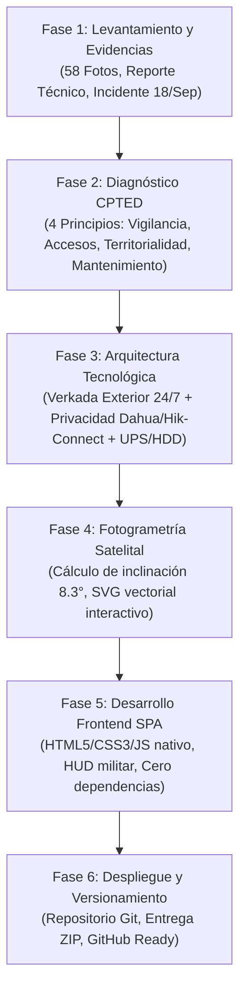
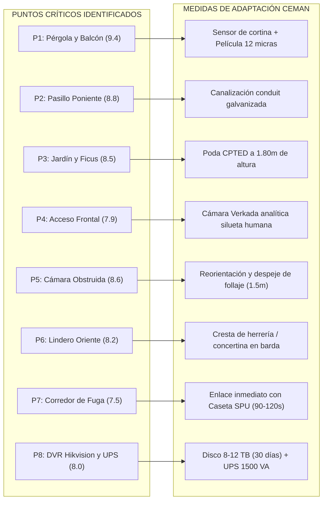

# Informe Metodológico: Análisis de Riesgos, Diagnóstico CPTED y Plataforma Táctica Interactiva
**Inmueble:** Residencia Unifamiliar, Circuito de los Volcanes 19, Fraccionamiento Lomas de Cocoyoc, Atlatlahucan, Morelos.  
**Coordenadas Geográficas:** 18.921390° N, -98.920426° W  
**Fecha de Elaboración:** Octubre / Noviembre 2026  
**Finalidad:** Documento técnico y metodológico explicativo para sustentar ante terceros (clientes, directores de seguridad, aseguradoras o comités vecinales) cómo se diseñó, estructuró y desarrolló la plataforma interactiva del proyecto.

---

## 1. Resumen Ejecutivo de la Metodología

La elaboración del proyecto no se basó en una plantilla genérica ni en estimaciones subjetivas. Siguió una **metodología híbrida integral de 6 fases secuenciales**, que combinó:
1. **Auditoría física de seguridad y análisis forense de campo** a partir de inspecciones previas y un incidente registrado de intrusión (18 de septiembre de 2026).
2. **Criminología Ambiental aplicada bajo el estándar CPTED** (*Crime Prevention Through Environmental Design*).
3. **Arquitectura de ciberseguridad y privacidad híbrida** (separación estricta entre monitoreo perimetral 24/7 y privacidad interior del usuario).
4. **Análisis fotogramétrico satelital y calibración angular vectorial** para proyectar con precisión milimétrica la huella de la casa sobre la ortofoto aérea.
5. **Desarrollo de Software Web Táctico Interactivo (Single Page Application)** con código nativo, autónomo y sin dependencias externas.
6. **Control de Calidad (QA), trazabilidad y versionamiento Git**, empaquetado para despliegue ejecutivo local o en la nube (GitHub Pages).



---

## 2. Desglose Fase por Fase

### Fase 1: Levantamiento de Campo, Clasificación de Evidencia y Datos de Entrada

#### 1.1. Análisis del Terreno e Historial del Inmueble
* Se partió de la dirección física oficial y coordenadas GPS satelitales en el Fraccionamiento Lomas de Cocoyoc, municipio de Atlatlahucan, Morelos.
* Se tomó como antecedente fáctico el evento de intrusión ocurrido el **18 de septiembre de 2026**, extrayendo las dinámicas de aproximación del infractor, los vectores de escape hacia la calle principal y los tiempos de reacción de la patrulla privada interna (Sociedad de Colonos / SPU: **90 a 120 segundos**).

#### 1.2. Clasificación Factual de las 58 Fotografías de Inspección
Para no inventar información ni generar confusiones en la inspección, las 58 fotografías de alta definición provistas se segregaron en dos universos claramente etiquetados:
* **Fotos 01 a 35 (Residencia Analizada - Volcanes 19):**
  * Fachada, zaguán y portón vehicular en Circuito de los Volcanes.
  * Pasillo de servicio poniente con instalaciones eléctricas y cableado coaxial/UTP expuesto.
  * Jardín posterior delimitado por setos de ficus de más de 3.5 metros de altura.
  * Pérgola metálica estructural y descanso exterior de escalera hacia el balcón superior.
  * Interiores de la residencia, cocina, ventanales corredizos y ubicación del grabador DVR Hikvision.
* **Fotos 36 a 58 (Inmueble Contiguo / Vecino Oriente):**
  * Casa de fin de semana desocupada la mayor parte del año.
  * Muro divisorio bajo con malla ciclónica simple de aproximadamente 1.60 m.
  * Áreas despejadas que ofrecen una plataforma o "trampolín" ideal para el ingreso no observado a Volcanes 19.

---

### Fase 2: Diagnóstico CPTED (Prevención del Delito Mediante el Diseño Ambiental)

El estándar CPTED evalúa cómo la infraestructura física, la arquitectura y la vegetación influyen en el comportamiento humano y en la toma de decisiones del infractor. Se diagnosticaron 4 principios:

| Principio CPTED | Hallazgo en Circuito de los Volcanes 19 | Calificación de Riesgo | Medida Correctiva Implementada |
| :--- | :--- | :---: | :--- |
| **1. Vigilancia Natural** | **Ficus ciego (>3.5 m)** en jardín posterior que bloquea completamente la visión de vecinos y guardias hacia el fondo. Obstrucción nocturna de cámaras por follaje que provoca rebote del halo infrarrojo. | **8.5 / 10 (Alto)** | Poda correctiva a 1.80 m de altura, manteniendo la línea de visión natural y despeje de 1.5 m en conos de visión de CCTV. |
| **2. Control Natural de Accesos** | **Pérgola estructural de acero** que sirve de escalera directa al balcón de la recámara principal (vía de escalada en menos de 10 segundos). Ventanales sin película de seguridad. | **9.4 / 10 (Crítico)** | Instalación de sensor perimetral de cortina exterior en losa superior, película de seguridad anti-impacto (12 micras) y sensores de apertura magnética. |
| **3. Reforzamiento Territorial** | **Lindero oriente con casa deshabitada** protegido únicamente por malla ciclónica baja (1.60 m). Vector de fuga hacia calle principal sin barreras intermedias. | **8.2 / 10 (Alto)** | Colocación de cresta de herrería punzonada / concertina galvanizada en remate de barda y sensor perimetral infrarrojo de cruce de línea. |
| **4. Mantenimiento y Resiliencia** | **Cables sueltos colgados** en pasillo poniente vulnerables a sabotaje. Grabador con almacenamiento de sólo 7-9 días y sin respaldo de energía (apagón ante corte de CFE). Corredor de evasión directo entre el acceso posterior (18.921626, -98.920526) y salida vial frontal (18.921251, -98.920436) hacia Caseta SPU y Autopista 115D. | **8.8 / 10 (Alto)** | Canalización metálica rígida (tubería conduit galvanizada pared gruesa), disco duro especializado de 8-12 TB, UPS de 1500 VA y control perimetral activo en corredor. |

---

### Fase 3: Arquitectura Tecnológica y Política de Privacidad

Uno de los mayores retos en la seguridad residencial de alto nivel es el dilema entre **seguridad efectiva** y **privacidad familiar**. Para resolverlo metodológicamente, se formuló una regla operativa estricta:

```
                            ┌──────────────────────────────────────────────┐
                            │    CENTRO DE CONTROL Y MONITOREO (SOC)       │
                            │             CEMAN 24/7 / SPU                 │
                            └──────────────────────▲───────────────────────┘
                                                   │
                                     ENLACE EXTERIOR PROACTIVO
                                     (Analítica Silueta Humana)
                                                   │
       ┌───────────────────────────────────────────┴───────────────────────────────────────────┐
       │                                                                                       │
┌──────┴───────────────────────────┐                                       ┌───────────────────┴───────────────────┐
│     PERÍMETRO Y EXTERIOR         │                                       │          INTERIOR RESIDENCIAL         │
│  2 a 4 Cámaras Verkada / Dahua   │                                       │   4 Cámaras Dahua (Salas / Recámaras) │
├──────────────────────────────────┤                                       ├───────────────────────────────────────┤
│ • Detección de intrusión nocturna│                                       │ • 100% PRIVADAS para el propietario   │
│ • Analítica de merodeo           │                                       │ • Visualización exclusiva Hik-Connect │
│ • Alerta inmediata a Caseta SPU  │                                       │ • ACCESO NULO PARA EL SOC / TERCEROS  │
│ • Despacho en 90 - 120 segundos  │                                       │ • Cero transmisión de video al exterior│
└──────────────────────────────────┘                                       └───────────────────────────────────────┘
```

#### Especificaciones Técnicas del Ecosistema de Monitoreo:
1. **Grabador y Almacenamiento:** Ampliación a grabador Hikvision de 16 canales con disco duro para videovigilancia continua (WD Purple / Seagate SkyHawk) de 8 a 12 TB, alcanzando **30 días garantizados de grabación local a 1080p** (superando la debilidad de las casas de fin de semana que quedan desatendidas semanas continuas).
2. **Autonomía Eléctrica:** Incorporación de un Sistema de Alimentación Ininterrumpida (UPS) de 1500 VA con supresor de picos, asegurando hasta 60 minutos de operación continua ante fallas de CFE o intento deliberado de corte de fusibles en el murete exterior.
3. **Escalamiento Operativo:** Protocolo de verificación mediante doble factor (cruce analítico + confirmación de patrulla SPU en menos de 2 minutos).

---

### Fase 4: Fotogrametría Satelital y Calibración Angular

La imagen satelital proporcionada mostraba una perspectiva cenital pero la traza urbana de la calle Circuito de los Volcanes genera una alineación diagonal.

#### 4.1. Detección del Ángulo de Rotación
* Se midió la inclinación de las líneas de colindancia poniente y oriente del lote, así como el remate de la cumbrera del tejado de teja roja.
* Se obtuvo una pendiente constante:
  $$\frac{\Delta X}{\Delta Y} \approx \frac{26\,\text{px}}{180\,\text{px}} \approx 0.1444 \implies \theta = \arctan(0.1444) \approx 8.22^\circ \approx 8.3^\circ$$
* Por lo tanto, un rectángulo horizontal/vertical ortogonal simple resultaba erróneo. Se trazó un polígono de 8 vértices rotado fielmente a la derecha:
  $$\text{Polígono Residencia: } (448, 178) \to (518, 169) \to (552, 164) \to (572, 182) \to (586, 362) \to (530, 368) \to (524, 356) \to (470, 350)$$
  $$\text{Límite Predial del Terreno: } (436, 92) \to (566, 75) \to (592, 375) \to (462, 388)$$

#### 4.2. Estabilidad de los Elementos Interactivos en SVG
* **Diagnóstico del Fallo de Salto/Vibración (Hover Jitter):** Al aplicar `transform: scale(1.2)` en el elemento `<g>` del pin, el centro de escala se tomaba desde el origen `(0,0)` de la pantalla, desplazando el pin hasta 120 píxeles fuera del puntero, lo que disparaba eventos cíclicos de `mouseenter` y `mouseleave` a 60 fotogramas por segundo (flicker incontrolable).
* **Solución de Ingeniería:**
  * Se fijaron rígidamente las coordenadas de cada pin en SVG (`cx`, `cy`).
  * Se dotó a cada pin de un círculo hitbox transparente de **22 píxeles de radio**, facilitando el clic sin perder el puntero.
  * La animación de realce se aplicó exclusivamente al radio interno (`r: 10` a `12`) y al pulso perimetral, logrando un movimiento 100% estático y suave al interactuar.

---

### Fase 5: Desarrollo de la Interfaz Web (SPA) y Control de Calidad

Para asegurar que el proyecto pudiera presentarse en cualquier computadora sin necesidad de instalar servidores locales (Node.js, Python o XAMPP), se desarrolló bajo una arquitectura **Vanilla Offline-First**:

1. **Autonomía de Recursos:**
   * La imagen satelital en alta resolución fue optimizada e incrustada en formato Data URI Base64 dentro del archivo `index.html`.
   * Cero fuentes externas bloqueantes de Google Fonts o librerías CDN externas: se utilizan pilas de fuentes del sistema (`Segoe UI`, `-apple-system`, `Roboto`, `Arial`), garantizando que la página abre instantáneamente aun sin conexión a internet.
2. **Eliminación Absoluta de Mojibake (Caracteres Rotos):**
   * Se sustituyeron todos los caracteres con tildes, eñes y signos ortográficos por **entidades HTML estándar** (`&aacute;`, `&eacute;`, `&iacute;`, `&oacute;`, `&uacute;`, `&ntilde;`, `&bull;`, `&deg;`).
   * Esto previene que diferentes configuraciones regionales de Windows o Linux alteren la tipografía técnica.
3. **Módulos del Sistema Interactivo:**
   * **HUD Superior:** Ficha técnica ejecutiva con indicadores de riesgo global, fecha del incidente y banner permanente de política de privacidad.
   * **Barra de Acceso Rápido:** Píldoras de filtrado directo para cada uno de los 8 puntos críticos con código cromático según el nivel de severidad (Crítico = Rojo, Alto = Ámbar/Púrpura, Medio = Cian/Azul).
   * **Conmutador de Capas Tácticas (Layer Toggles):** Casillas de verificación para encender o apagar de forma independiente la silueta de la casa, el límite del predio, los pines y el vector de escape.
   * **Ficha Táctica Dinámica:** Conecta cada punto con su diagnóstico CPTED, medidas de solución recomendadas y carrusel de fotografías específicas de inspección.
   * **Galería Fotográfica Factual:** Muestra las 58 evidencias de campo numeradas objetivamente (`Foto 01` a `Foto 58`), con visor en pantalla completa (Lightbox) y navegación con flechas de teclado.
   * **Pestaña Criminológica SESNSP:** Métricas de incidencia delictiva del fuero común para contextualizar la vulnerabilidad territorial de Morelos.

---

### Fase 6: Versionamiento Git, Trazabilidad y Empaquetado

1. **Gestión de Versiones (Git):**
   * El proyecto se inicializó como un repositorio Git local en la ruta oficial:  
     `C:\Users\PISA27\Documents\analisis-riesgo-lomas-cocoyoc`
   * Cada ajuste solicitado por el usuario cuenta con un commit documentado y trazable (`Initial commit`, `Ajuste ortogonal y estabilidad de pines`, `Ajuste v5 con inclinación real y limpieza de títulos`).
2. **Empaquetado Listo para Distribución:**
   * Se generó un archivo comprimido integral: `C:\Users\PISA27\Documents\analisis-riesgo-lomas-cocoyoc.zip` (26.9 MB), que contiene la página web, el mapa táctico de alta resolución y las 58 imágenes organizadas en la carpeta `img/`.
   * El código está listo para ser alojado en cualquier repositorio remoto (como GitHub Pages) o ser compartido mediante USB o correo corporativo.

---

## 3. Resumen de Puntos Críticos y Soluciones de Seguridad



---

## 4. Argumentario para Presentación a Terceros

Al explicar este proyecto a un cliente, socio o tercero interesado, se sugiere estructurar la presentación en **4 mensajes clave**:

1. **"No vendemos fierros por vender, diagnosticamos el entorno":**  
   El análisis demuestra que la residencia ya contaba con 11 cámaras de calidad, pero eran vulnerables por fallas de diseño ambiental (árboles demasiado altos, cables expuestos y pérgolas que funcionan como escaleras). La solución optimiza lo existente antes de proponer cambios mayores.
2. **"Privacidad absoluta en el interior":**  
   El monitoreo profesional 24/7 de CEMAN se limita estrictamente al exterior de la propiedad. Ningún monitorista tiene acceso a las cámaras de salas o recámaras; esas quedan reservadas para la vista privada del propietario en su teléfono móvil.
3. **"Detección antes del allanamiento, no después":**  
   Gracias a la analítica de silueta humana y los sensores de cruce exterior, la alerta a la patrulla del fraccionamiento (SPU) se genera en el perímetro, antes de que el intruso toque una puerta o ventana.
4. **"Plataforma interactiva profesional y transparente":**  
   El informe no es un PDF estático aburrido: es una herramienta táctica interactiva que permite a cualquier evaluador dar clic en el mapa satelital, ver la foto real del problema y contrastarla con la solución técnica recomendada.

---
*Documento de respaldo metodológico generado para el proyecto de seguridad y análisis de riesgos en Lomas de Cocoyoc.*
