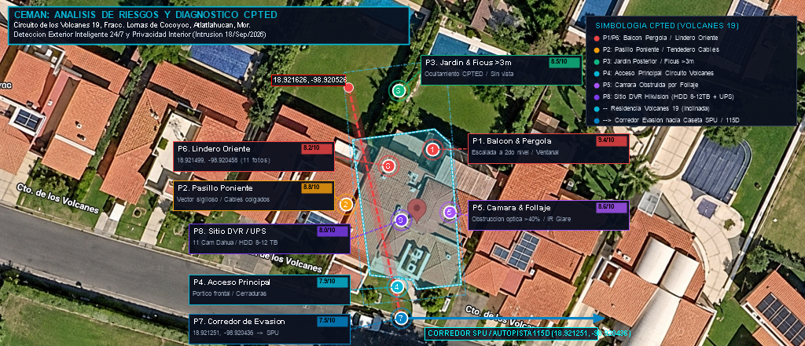

# 🏡 CEMAN | Dictamen de Seguridad Patrimonial, Diagnóstico CPTED y Propuesta de Monitoreo CCTV 24/7
### Residencia Particular — Circuito de los Volcanes 19, Fraccionamiento Lomas de Cocoyoc
#### Municipio de Atlatlahucan, Morelos • C.P. 62847

[](LICENSE)
[](#-despliegue-en-vivo-github-pages)
[](ANALISIS_RIESGOS_COCOYOC.md)
[](data/indicadores_atlatlahucan.json)
[](data/puntos_criticos_cocoyoc.geojson)

Proyecto integral de criminología ambiental (CPTED), auditoría de infraestructura física/electrónica y propuesta de **Monitoreo Remoto Exterior 24/7/365** para la residencia unifamiliar ubicada en **Circuito de los Volcanes No. 19**, Fraccionamiento Lomas de Cocoyoc, Atlatlahucan, Morelos, elaborado por **CEMAN (Centro de Monitoreo y Análisis de Seguridad)** en respuesta al evento de **intrusión reportado el 18 de septiembre de 2026**.

---

## 📍 Identificación del Inmueble y Coordenadas

* **Inmueble:** Residencia particular unifamiliar de dos niveles.
* **Ubicación:** Circuito de los Volcanes No. 19, Fracc. Lomas de Cocoyoc, C.P. 62847, Atlatlahucan, Morelos.
* **Coordenadas Geográficas:** `18.921390° N, -98.920426° W`
* **Evento Crítico Detonante:** Intrusión perimetral no autorizada reportada el **18 de septiembre de 2026**.



---

## 🔒 Compromiso Inviolable de Privacidad Interior

> [!IMPORTANT]
> **DELIMITACIÓN ESTRICTA DEL MONITOREO:**  
> La infraestructura existente cuenta con **11 cámaras Dahua** (4 traseras, 3 frontales y 4 interiores) conectadas a un DVR Hikvision AcuSense.  
> **Las 4 cámaras interiores quedan estrictamente excluidas de cualquier monitoreo o transmisión externa**, reservándose de forma exclusiva para la consulta privada de la habitante mediante su aplicación móvil. El servicio de monitoreo externo 24/7 opera de manera exclusiva sobre la **detección inteligente exterior (cámaras Verkada y sensores perimetrales)**.

---

## 📊 Síntesis de la Incidencia Delictiva (Atlatlahucan & Lomas de Cocoyoc)

Basado en datos oficiales del **Secretariado Ejecutivo del Sistema Nacional de Seguridad Pública (SESNSP)**, CONAPO y la encuesta ENVIPE (INEGI):

* **Tasa Crítica de Robo a Casa Habitación:** Atlatlahucan registra **66.4 carpetas por cada 100 mil habitantes** (19 carpetas anuales en corte móvil a septiembre 2026).
  * **+19.8%** por encima de la media del Estado de Morelos (55.4).
  * Prácticamente **triplica (+178.9%)** la media nacional de México (23.8).
* **Vivienda de Descanso Deshabitada:** El fraccionamiento cuenta con alto porcentaje de casas de fin de semana, lo que crea ventanas de oportunidad durante días hábiles.
* **Cifra Negra (>92.4% en Morelos):** La gran mayoría de conatos e intrusiones menores son resueltos o contenidos internamente por el **Grupo de Vigilancia de Servicios Públicos Urbanos (SPU)** del fraccionamiento sin dar vista al Ministerio Público.
* **Incidentes Documentados en 2026 en Lomas de Cocoyoc:**
  1. *20/Feb/2026 (Calle Pirul):* Detención de dos personas armadas tras intento de invasión/ocupación de inmueble y amenazas.
  2. *12/Ago/2026 (Calle Villas de Yautepec):* Captura en flagrancia de sujeto sustrayendo tuberías de cobre en vivienda deshabitada.
  3. *18/Sep/2026 (Circuito de los Volcanes 19):* Intrusión perimetral reportada por la propietaria (evento de referencia).

---

## 🔍 Diagnóstico CPTED de Puntos Críticos (P1 al P8)

A partir de la inspección visual de las **35 fotografías de la residencia**:

1. 🔴 **P1 — Balcón Superior y Pérgola (Score: 9.4/10 • Crítico):**
   * *Diagnóstico:* La pérgola metálica baja y el descanso de la escalera exterior forman una escalera estructural para trepar al balcón del segundo piso y acceder a las recámaras.
   * *Solución:* Sensor perimetral de cortina, película de seguridad anti-impacto (12 micras) en ventanales corredizos y cámara Verkada exterior.
2. 🟠 **P2 — Pasillo Lateral Poniente (Score: 8.8/10 • Alto):**
   * *Diagnóstico:* Pasillo estrecho y en penumbra; tendedero desordenado de cables coaxiales/eléctricos colgando; calentador de gas vulnerable.
   * *Solución:* Canalización en tubería conduit metálica de 3/4", luminaria LED disuasiva con sensor PIR de encendido instantáneo.
3. 🟢 **P3 — Jardín Posterior & Setos de Ficus >3m (Score: 8.5/10 • Alto):**
   * *Diagnóstico:* Setos de ficus densos que superan los 3 metros y bloquean toda la vigilancia natural recíproca con vecinos.
   * *Solución:* Poda técnica bajo la "Regla CPTED de los 2 metros" (copas >2.2m, arbustos <1.0m) y analítica de detección de silueta humana.
4. 🔵 **P4 — Acceso Principal Circuito de los Volcanes (Score: 7.9/10 • Medio-Alto):**
   * *Diagnóstico:* Pórtico frontal techado; visibilidad parcial hacia la calle; cerraduras estándar de herrería.
   * *Solución:* Cerraduras de alta seguridad anti-bumping, luz de cortesía LED permanente y contacto magnético supervisado.
5. 🟣 **P5 — Falla CCTV: Cámara Obstruida por Follaje (Score: 8.6/10 • Alto):**
   * *Diagnóstico:* Cámara exterior en plafón cubierta en más del 40% por hojas de ficus; deslumbramiento nocturno por infrarrojo (*IR glare*) y falsas alarmas por viento.
   * *Solución:* Poda de despeje inmediato, reubicación del soporte y ajuste de analítica de exclusión de follaje.
6. 🔴 **P6 — Colindancia Oriente (Score: 8.2/10 • Alto):**
   * *Diagnóstico:* Barda baja con malla ciclónica divisoria con casa vecina; riesgo de salto ("efecto trampolín") desde predio desocupado.
   * *Solución:* Concertina/cresta de acero en remate superior y sensor de corte/vibración perimetral.
7. 🔵 **P7 — Corredor de Fuga hacia Caseta SPU (Score: 7.5/10 • Medio-Alto):**
   * *Diagnóstico:* Vía de escape vehicular hacia Av. de los Volcanes, caseta de vigilancia SPU y Carretera 115D.
   * *Solución:* Protocolo de notificación remota en &lt;60s al Grupo de Vigilancia SPU para cierre de plumas en caseta.
8. 🟣 **P8 — Sitio Técnico DVR Hikvision & Respaldo (Score: 8.0/10 • Alto):**
   * *Diagnóstico:* DVR con HDD de 1-2 TB (riesgo de sobrescritura en 9 días); carencia de respaldo eléctrico ante apagones.
   * *Solución:* Disco duro de 8-12 TB (30-45 días de retención garantizada) y UPS de 1500 VA (60 minutos de autonomía).

---

## 📂 Estructura del Repositorio

```bash
analisis-riesgo-lomas-cocoyoc/
│
├── index.html                   # Aplicativo web interactivo (con visor táctico y galería de 58 fotos)
├── ANALISIS_RIESGOS_COCOYOC.md  # Dictamen técnico y criminológico exhaustivo
├── mapa_tactico_cocoyoc.png     # Render cartográfico en alta resolución con polígono y pines
├── data/
│   ├── puntos_criticos_cocoyoc.geojson # Puntos georreferenciados y metadatos de riesgo
│   ├── indicadores_atlatlahucan.json   # Cifras estadísticas oficiales SESNSP / INEGI
│   └── manifest_fotos.json             # Catálogo de las 58 fotografías de inspección
├── img/
│   ├── satelital_cocoyoc.jpg           # Ortofoto satelital base calibrada (1024 x 491)
│   ├── residencia_volcanes19_01.jpg .. 35.jpg # Fotos del inmueble en análisis
│   └── casa_contigua_01.jpg .. 23.jpg         # Fotos de referencia de la casa contigua
├── .gitignore                   # Exclusiones de Git
├── LICENSE                      # Licencia de código abierto MIT
└── README.md                    # Documentación ejecutiva del proyecto
```

---

## 🚀 Despliegue en Vivo (GitHub Pages)

Para visualizar este aplicativo web interactivo en línea sin necesidad de instalar ningún servidor:
1. Sube el contenido de esta carpeta a tu repositorio de GitHub (`main`).
2. Ve a **Settings** > **Pages** en tu repositorio de GitHub.
3. En **Source**, selecciona `Deploy from a branch` y elige `main` / `/(root)`.
4. En 1-2 minutos tendrás tu enlace público activo:
   `https://<tu-usuario>.github.io/<nombre-del-repo>/`

---

## 📄 Licencia
Este proyecto se distribuye bajo los términos de la Licencia MIT. Consulta el archivo [LICENSE](LICENSE) para más detalles.
